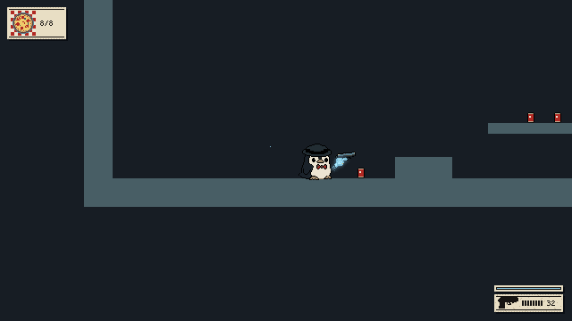
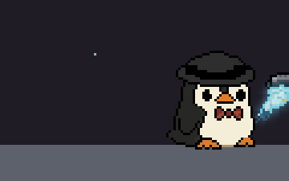
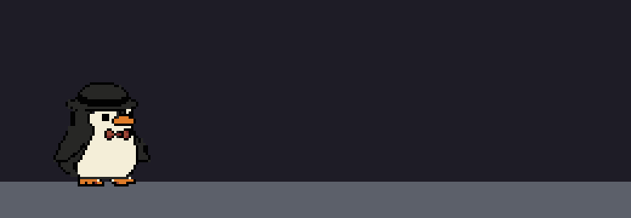

<p align="center">
  
</p>

<p align="center">
  <b>A 2D slow‑motion action platformer about a mafia penguin.</b><br>
  Inspired by the original <i>My Friend Pedro</i> flash game · made in <b>Godot 4</b> with <b>GDScript</b>
</p>

<p align="center">
  
  
  
  
</p>

---

**Ricco** is about one meter tall, "pure muscle" (his words) and loves pizza a little too much.
When the Don is murdered, his ghost refuses to leave – he holds Ricco's gun with a spectral hand
and, for a few seconds at a time, **slows down the world** around him.

This is a full remake of my old high‑school project (SOČ), rebuilt from scratch, step by step.

<p align="center">
  
</p>

## ✨ Features so far

| | |
|---|---|
| **Tight platforming** – acceleration, coyote time, jump buffering, variable jump height, a penguin waddle | **Wall slide & wall jump** – only off real walls, not thin platforms |
| **Ledge grab & climb** – hang on an edge, press jump to climb up | **Mouse aiming** – Ricco faces where he aims |
| **The Don's ghost hand** holds the pistol; a second ghost hand brings a fresh magazine when reloading | **Real ammo** – limited magazines, empty mags drop to the floor and bounce |
| **Slow‑mo ("focus")** – the world slows down, the screen turns ghost‑blue, Ricco leaves afterimages | **Boomerang hat** – throw the fedora, it flies back to Ricco |
| **Health** – hits, short invulnerability, death & restart | **Noir HUD** – two styles (noir ticket / minimal), pixel font with full Slovak diacritics |

<p align="center">
  
  
  
</p>

## 🎮 Controls

| Key | Action |
|---|---|
| `A` `D` / arrows | move |
| `Space` / `W` | jump, wall jump, climb a ledge |
| Left mouse | shoot |
| Right mouse / `E` | throw the hat |
| `R` | reload |
| `Shift` | slow‑mo (the Don's ghost) |
| `F2` | switch HUD style |
| `F1` | hide the controls overlay |
| `K` / `H` | *debug:* take a hit / heal (until enemies exist) |

## 🗺️ Roadmap

- [x] Movement, wall jump, ledge grab
- [x] Pistol, magazines, ghost‑hand reload
- [x] Boomerang hat
- [x] Slow‑mo with the Don's ghost
- [x] Health, death & restart
- [ ] Belly slide (penguin style)
- [ ] First enemies – mafia goons
- [ ] Human shield, bombs
- [ ] Weapons & loadout – 1 sidearm + 2 primaries (Tommy gun, lupara, revolver…)
- [ ] Swimming and ice – secrets & puzzles
- [ ] Style meter / combos, reputation with the Don
- [ ] Bosses weak to specific abilities, abilities unlocked level by level
- [ ] Arena mode
- [ ] Story & dialogue
- [ ] A small 3D retro car race (a tribute to a certain 2002 mafia game 🚗)

## 🛠️ Tech

- **Godot 4.7** (Forward+), **GDScript** with static typing, PC only
- Pixel‑art resolution **640×360**, integer scaling
- Addons: [Phantom Camera](https://github.com/ramokz/phantom-camera), [Aseprite Wizard](https://github.com/viniciusgerevini/godot-aseprite-wizard), [LimboAI](https://github.com/limbonaut/limboai), [Dialogic 2](https://github.com/dialogic-godot/dialogic)

```
characters/ricco/   player: movement, weapons, ghost hands, slow‑mo, sprites
weapons/            pistol, bullets, magazines, hat
ui/                 HUD (ammo, health, slow‑mo meter), fonts, theme
levels/             test room
settings/           game settings (saved to user://settings.cfg)
tools/              editor scripts (builds Ricco's SpriteFrames)
```

### Running it
1. Install [Godot 4.7](https://godotengine.org/download)
2. Clone the repo (it uses **Git LFS** for images: `git lfs install` first)
3. Open `project.godot` and press **F5**

## 🙏 Credits

- **Font:** [Tiny5](https://github.com/Gissio/font_tiny5) by Gissio – SIL Open Font License (`ui/fonts/Tiny5_OFL.txt`)
- **Character art:** generated with PixelLab and Google Gemini, then cleaned up into pixel art by hand/script
- **Addons:** see each addon's own license in `addons/`
- Inspired by *My Friend Pedro* by DeadToast Entertainment

---
