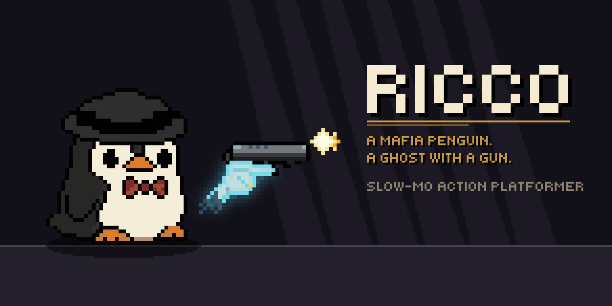

<p align="center">
  
</p>

<p align="center">
  <b>A 2D slow‑motion action platformer about a mafia penguin.</b><br>
  Inspired by the original <i>My Friend Pedro</i> flash game · made in <b>Godot 4</b> with <b>GDScript</b>
</p>

<p align="center">
  
  
  
  
</p>

---

**Ricco** is about one meter tall, "pure muscle" (his words) and loves pizza a little too much.
One night Don Vito calls him to the pizzeria – *"back way, nobody sees you"*. Ricco finds the Don dying in the
cellar, and the Don's ghost refuses to leave: he lends Ricco his hands to hold a gun and, for a few seconds
at a time, **slows down the world**.

This is a full remake of my old high‑school project (SOČ), rebuilt from scratch, step by step.

<p align="center"></p>

A prologue without a gun – sneak, hide in the dark, and find out who got the Don.

| | |
|---|---|
|  |  |
| **The street** – rain, neon, a bouncer at the door. Learn to move, jump, grab ledges, slide and wall jump. | **The restaurant** – a private party. Stay up in the dark; if a guest sees you, they scream for the goons. |
|  |  |
| **The tunnels** – a maze of old prohibition tunnels. Follow the blood, avoid the flashlights. | **The Don's hideout** – a dying Don, his ghost, and Ricco's first gunfight. |

Along the way: a kitchen and a storage room full of guards, and a speakeasy door that only opens to the right knock.

<p align="center"></p>

- **Tight platforming** – coyote time, jump buffering, variable jump, ledge grab, wall jump, penguin belly slide
- **Stealth** – light and darkness, sneaking, silent takedowns from behind, a hat throw that stuns (or puts out a lamp)
- **The Don's ghost** – a spectral hand holds the pistol and reloads it; slow‑mo turns the screen ghost‑blue
- **Real ammo** – limited magazines, empty mags drop and bounce
- **Mafia goons** built from body parts, with patrols, flashlights and different weapons; party guests with randomized faces
- **Dialogue & cutscenes** – typewriter dialogue box with portraits
- **Settings** – custom cursor and crosshairs (with live previews), HUD styles, a retro filter

<p align="center"></p>

| Key | Action |
|---|---|
| `A` `D` / arrows | move |
| `Space` / `W` | jump, wall jump, climb a ledge |
| `S` / `Ctrl` | belly slide |
| `C` / `Alt` | sneak |
| `F` | takedown from behind · knock on a door |
| Right mouse / `E` | throw the hat |
| Left mouse | shoot |
| `R` | reload |
| `Shift` | slow‑mo (the Don's ghost) |
| `Esc` | pause menu & settings |

<p align="center"></p>

- [x] Movement, shooting, slow‑mo, the hat, health
- [x] First enemies, stealth, takedowns
- [x] **Chapter I** – street, restaurant, kitchen, storage, casino, tunnels, the Don
- [ ] **Chapter II – Wharf Rats** (in progress) – the Don's funeral at the cemetery ✔, the foggy docks ✔, Big Lou's cold storage (meat hooks & ice) ✔, the S.S. Margaret in a storm ✔, **boss fight with Big Lou** (3 phases: the bridge wing, the cargo crane, the burning ship) ✔, the escape next
- [ ] More weapons & loadout (Tommy gun, lupara, revolver…), human shield
- [ ] Next chapters – revenge, bosses, abilities unlocked level by level
- [ ] Style meter, secrets (swimming ✔, ice ✔)
- [ ] A small 3D retro car race (a tribute to a certain 2002 mafia game 🚗)

<p align="center"></p>

- **Godot 4.7**, **GDScript** with static typing, PC only
- Pixel‑art resolution **640×360**, integer scaling
- Addons: [Phantom Camera](https://github.com/ramokz/phantom-camera), [Aseprite Wizard](https://github.com/viniciusgerevini/godot-aseprite-wizard), [LimboAI](https://github.com/limbonaut/limboai), [Dialogic 2](https://github.com/dialogic-godot/dialogic)

```
characters/   Ricco (player), gangsters, the Don
levels/       level1 (street → restaurant → casino) + cellar (tunnels), level2 (cemetery + docks + cold storage), test room
world/        stealth (light zones), effects, NPCs (guests, rats, the dog), doors, cold storage (hook rails, conveyor)
weapons/      pistol, bullets, magazines, hat
ui/           HUD, dialogue box, menus, cursors, fonts
settings/     game settings (saved to user://settings.cfg)
tools/        generator scripts (Ricco's SpriteFrames, level 1 + cellar maps, level 2 map)
```

Level 1 and the cellar are generated by `tools/build_level1.gd`
(`godot --headless --path . --script res://tools/build_level1.gd`) – the cellar maze is a text map in that file.
Level 2 (the cemetery) is generated by `tools/build_level2.gd` the same way, the docks by `tools/build_docks.gd`, the cold storage by `tools/build_coldstore.gd`.

### Running it
1. Install [Godot 4.7](https://godotengine.org/download)
2. Clone the repo (it uses **Git LFS** for images: `git lfs install` first)
3. Open `project.godot` and press **F5**

<p align="center"></p>

- **Font:** [Tiny5](https://github.com/Gissio/font_tiny5) by Gissio – SIL Open Font License (`ui/fonts/Tiny5_OFL.txt`)
- **Character art:** generated with PixelLab and Google Gemini, then cleaned up into pixel art by hand/script
- **Sound effects:** CC0 (public domain) recordings – [Kenney](https://kenney.nl) (Impact Sounds, RPG Audio, Casino Audio), Ben Burnes (Organic Wooshes, Smol Mechanisms), [Warfork](https://github.com/Warfork) and *40 CC0 water SFX*, collected in [CC0-Public-Domain-Sounds](https://github.com/lavenderdotpet/CC0-Public-Domain-Sounds); the rest is generated procedurally
- **Addons:** see each addon's own license in `addons/`
- Inspired by *My Friend Pedro* by DeadToast Entertainment

---

<sub>🇸🇰 Ricco je remake môjho stredoškolského projektu SOČ – 2D akčná plošinovka s mafiánskym tučniakom, spomaľovaním času a duchom zavraždeného Dona.</sub>
